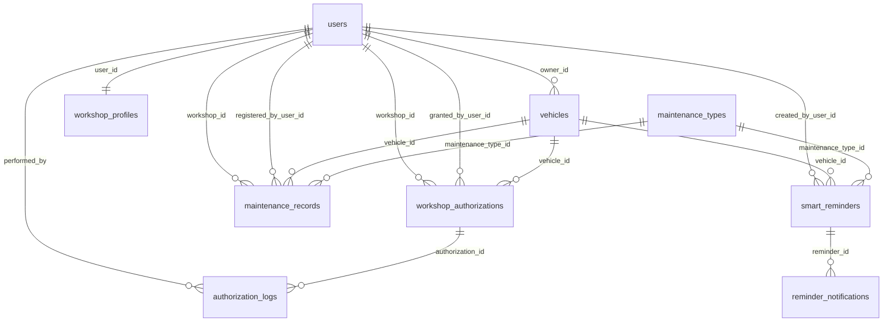

# BITA — Implementación del modelo de datos

Resumen de todo lo creado en el proyecto a partir del
`Informe Tecnico - Modelo de Datos BITA.pdf`, con las decisiones tomadas y el
motivo de cada una.

---

## 1. Resumen ejecutivo

Se reemplazó el dominio de ejemplo (cafetería: `orders`, `customers`, `dining`)
por el dominio real de BITA: propietarios, talleres, vehículos, mantenimientos,
autorizaciones y recordatorios inteligentes.

El alcance de esta entrega es **estructura, no lógica**:

| Capa | Estado |
|---|---|
| Entidades TypeORM (9 tablas) | Completas, con tipos, defaults, índices y relaciones |
| Autenticación (`auth`) | Completa y funcional (registro, login, `me`) |
| DTOs | Completos, con validación de entrada |
| Configuración de módulos | Cableada (TypeORM + controllers + providers) |
| Controllers y services de dominio | **Vacíos** (solo la clase y el decorador) |

Verificado con `npm run build`, ESLint y una prueba de construcción de metadata
de TypeORM (9 entidades, nombres de tabla y columna correctos).

---

## 2. Origen: qué pide el informe

El informe define 9 entidades:

1. `users` — cuentas del sistema (propietarios y talleres comparten tabla).
2. `workshop_profiles` — datos comerciales del taller, 1:1 con un usuario.
3. `vehicles` — vehículos, cada uno con un propietario.
4. `maintenance_types` — catálogo de tipos de mantenimiento.
5. `maintenance_records` — historial de servicios realizados.
6. `workshop_authorizations` — permiso de un taller sobre un vehículo.
7. `authorization_logs` — auditoría de otorgamientos y revocaciones.
8. `smart_reminders` — recordatorios por fecha o kilometraje.
9. `reminder_notifications` — envíos generados por esos recordatorios.

Y 9 endpoints:

```
GET    /vehicles
POST   /vehicles/:id/maintenance
GET    /vehicles/:id/maintenance
POST   /workshops/vehicles/:id/maintenance
POST   /vehicles/:id/authorizations
PATCH  /authorizations/:id/revoke
POST   /vehicles/:id/reminders
GET    /vehicles/:id/reminders
POST   /reminders/:id/complete
```

---

## 3. Estructura del proyecto

```
src/
├── app.module.ts                  # Config, TypeORM y los 7 módulos
├── app.controller.ts
├── app.service.ts
│
├── auth/                          # users + autenticación (COMPLETO)
│   ├── auth.controller.ts
│   ├── auth.service.ts
│   ├── auth.module.ts
│   ├── authenticated-user.interface.ts
│   ├── dto/
│   │   ├── login.dto.ts
│   │   └── register.dto.ts
│   ├── entities/
│   │   └── user.entity.ts
│   ├── guards/
│   │   └── jwt-auth.guard.ts
│   └── strategies/
│       └── jwt.strategy.ts
│
├── workshops/                     # workshop_profiles
│   ├── dto/{create,update}-workshop-profile.dto.ts
│   ├── entities/workshop-profile.entity.ts
│   ├── workshops.{controller,service,module}.ts
│
├── vehicles/                      # vehicles
│   ├── dto/{create,update}-vehicle.dto.ts
│   ├── entities/vehicle.entity.ts
│   ├── vehicles.{controller,service,module}.ts
│
├── maintenance-types/             # maintenance_types
│   ├── dto/{create,update}-maintenance-type.dto.ts
│   ├── entities/maintenance-type.entity.ts
│   ├── maintenance-types.{controller,service,module}.ts
│
├── maintenance-records/           # maintenance_records
│   ├── dto/create-maintenance-record.dto.ts
│   ├── dto/query-maintenance-records.dto.ts
│   ├── entities/maintenance-record.entity.ts
│   ├── maintenance-records.{controller,service,module}.ts
│
├── authorizations/                # workshop_authorizations + authorization_logs
│   ├── dto/create-authorization.dto.ts
│   ├── dto/revoke-authorization.dto.ts
│   ├── entities/workshop-authorization.entity.ts
│   ├── entities/authorization-log.entity.ts
│   ├── authorizations.{controller,service,module}.ts
│
└── reminders/                     # smart_reminders + reminder_notifications
    ├── dto/create-reminder.dto.ts
    ├── dto/complete-reminder.dto.ts
    ├── entities/smart-reminder.entity.ts
    ├── entities/reminder-notification.entity.ts
    ├── reminders.{controller,service,module}.ts
```

Cada módulo repite el patrón que ya traía el proyecto (`entities/`, `dto/`,
`*.controller.ts`, `*.service.ts`, `*.module.ts`), sin introducir convenciones
nuevas.

---

## 4. Modelo de entidades

Todas las claves primarias son `uuid` (`@PrimaryGeneratedColumn('uuid')`), tal
como exige el informe. Las columnas usan `snake_case` en base de datos vía
`name:` y `camelCase` en TypeScript.

### `users` → `UserEntity`

| Columna | Tipo | Regla |
|---|---|---|
| `id` | uuid | PK |
| `waid` | varchar(120) | unique, nullable (identificador de WhatsApp) |
| `email` | varchar(254) | unique |
| `password_hash` | text | `select: false` (nunca sale en consultas por defecto) |
| `phone` | varchar(30) | nullable |
| `is_active` | boolean | default `true` |
| `created_at` / `updated_at` | timestamptz | auditoría |

### `workshop_profiles` → `WorkshopProfileEntity`

| Columna | Tipo | Regla |
|---|---|---|
| `id` | uuid | PK |
| `user_id` | uuid | FK → `users.id`, unique (1:1), `CASCADE` |
| `name` | varchar(120) | nombre comercial |
| `business_name` | varchar(150) | nullable |
| `identification` | varchar(40) | nullable (NIT / documento) |
| `created_at` | timestamptz | — |

### `vehicles` → `VehicleEntity`

| Columna | Tipo | Regla |
|---|---|---|
| `id` | uuid | PK |
| `owner_id` | uuid | FK → `users.id`, `CASCADE`, indexado |
| `plate` | varchar(10) | unique |
| `brand` / `model` | varchar(60) | — |
| `year` | smallint | nullable |
| `current_kilometers` | integer | default `0` |
| `created_at` / `updated_at` | timestamptz | — |

### `maintenance_types` → `MaintenanceTypeEntity`

`id` uuid, `name` varchar(100), `description` text (nullable),
`default_interval_km` integer (nullable), `default_interval_months` integer
(nullable), `is_active` boolean default `true`.

### `maintenance_records` → `MaintenanceRecordEntity`

| Columna | Tipo | Regla |
|---|---|---|
| `id` | uuid | PK |
| `vehicle_id` | uuid | FK → `vehicles.id`, `CASCADE` |
| `maintenance_type_id` | uuid | FK → `maintenance_types.id`, `RESTRICT` |
| `workshop_id` | uuid | FK → `users.id`, **nullable**, `SET NULL` |
| `registered_by_user_id` | uuid | FK → `users.id`, `RESTRICT` |
| `service_date` | date | — |
| `kilometers` | integer | — |
| `cost` | numeric(12,2) | nullable, transformado a `number` en TS |
| `observations` | text | nullable |
| `created_at` | timestamptz | — |

Índice: `(vehicle_id, service_date)`.

### `workshop_authorizations` → `WorkshopAuthorizationEntity`

`id` uuid; `vehicle_id` FK `CASCADE`; `workshop_id` FK → `users.id` `CASCADE`;
`granted_by_user_id` FK → `users.id` `RESTRICT`; `can_read` boolean default
`true`; `can_write` boolean default `false`; `status` varchar(20) default
`'active'` (`active` | `revoked`). Índice `(vehicle_id, workshop_id)`.

### `authorization_logs` → `AuthorizationLogEntity`

`id` uuid; `authorization_id` FK `CASCADE`; `performed_by` FK → `users.id`
`RESTRICT`; `action` varchar(20) (`GRANT` | `REVOKE`); `metadata` jsonb
nullable; `created_at` timestamptz.

### `smart_reminders` → `SmartReminderEntity`

`id` uuid; `vehicle_id` FK `CASCADE`; `created_by_user_id` FK → `users.id`
`CASCADE`; `maintenance_type_id` FK nullable `SET NULL`; `title` varchar(150);
`description` text nullable; `criteria` varchar(20) (`due_date` |
`due_kilometers`); `due_date` date nullable; `due_kilometers` integer nullable;
`lead_days` integer default `7`; `lead_kilometers` integer default `500`;
`recurring` boolean default `false`; `recurrence_days` integer nullable;
`recurrence_km` integer nullable; `status` varchar(20) default `'pending'`;
`last_notified_at` timestamptz nullable.

Índice: `(due_date, due_kilometers)`.

### `reminder_notifications` → `ReminderNotificationEntity`

`id` uuid; `reminder_id` FK `CASCADE`; `channel` varchar(20) (`whatsapp` |
`email`); `notification_type` varchar(40); `scheduled_for` timestamptz;
`sent_at` timestamptz nullable; `status` varchar(20) default `'pending'`;
`idempotency_key` varchar(120) **unique**; `error_message` text nullable.

### Diagrama de relaciones



---

## 5. Autenticación (lo único con lógica)

Se migró el `auth` que ya existía al nuevo esquema:

- **`UserEntity` pasó de `id` numérico a `uuid`**, porque el informe lo exige y
  todas las FKs del modelo apuntan a `users.id`.
- **`POST /auth/register`** (`RegisterDto`: email + password):
  normaliza el email a minúsculas, hashea con **Argon2id** y captura el error
  `23505` de Postgres para devolver `409 Conflict` si el email ya existe.
- **`POST /auth/login`** (`LoginDto`: email + password):
  selecciona explícitamente `password_hash` (la columna tiene `select: false`),
  rechaza usuarios con `is_active = false`, verifica con `argon2.verify` y firma
  un JWT `HS256` de 15 minutos con `sub = user.id` (uuid).
- **`GET /auth/me`** protegido con `JwtAuthGuard` (Passport `jwt`) y tipado con
  la interfaz `AuthenticatedUser`.
- **`JwtStrategy`**: además de validar la firma, comprueba que el `sub` tenga
  formato UUID (evita que un token manipulado provoque un error 500 en Postgres)
  y que el usuario siga existiendo y activo.
- **`AuthModule`**: `JWT_SECRET` obligatorio, con mínimo de 64 caracteres
  validado al arrancar.

`waid` y `phone` quedaron como columnas nullable: no se piden en el registro,
se llenan después (por ejemplo al vincular el número de WhatsApp).

---

## 6. DTOs y validación

Todos los DTOs usan `class-validator`; los controllers aplican un
`ValidationPipe` con `transform`, `whitelist` y `forbidNonWhitelisted`, igual
que ya hacía el proyecto.

| Módulo | DTOs |
|---|---|
| `auth` | `RegisterDto` (email, password 8–15 con regex), `LoginDto` (email, password) |
| `workshops` | `CreateWorkshopProfileDto`, `UpdateWorkshopProfileDto` |
| `vehicles` | `CreateVehicleDto` (placa hasta 10 caracteres alfanuméricos, marca, modelo, año 1900–2100, km ≥ 0), `UpdateVehicleDto` |
| `maintenance-types` | `CreateMaintenanceTypeDto`, `UpdateMaintenanceTypeDto` |
| `maintenance-records` | `CreateMaintenanceRecordDto` (`maintenanceTypeId` uuid, `workshopId` uuid opcional, fecha ISO, km, costo 2 decimales, observaciones), `QueryMaintenanceRecordsDto` |
| `authorizations` | `CreateAuthorizationDto` (`workshopId` uuid, `canRead`, `canWrite`), `RevokeAuthorizationDto` |
| `reminders` | `CreateReminderDto` (criterio `due_date` / `due_kilometers` y sus campos), `CompleteReminderDto` |

Los DTOs de un dominio viven en el módulo dueño de ese dominio, no en
`vehicles`, aunque los endpoints cuelguen de `/vehicles/:id/...`.

**Reglas de negocio deliberadamente NO implementadas aquí** (son lógica, no
estructura): fecha de mantenimiento no futura, kilometraje no inferior al
último registrado, autorización activa obligatoria para que un taller registre
(403), reprogramación de recurrentes y cron diario de avisos.

---

## 7. Módulos y endpoints

Los `*.service.ts` y `*.controller.ts` de dominio son **clases vacías**:

```ts
@Controller('vehicles')
export class VehiclesController {}
```

Los `*.module.ts` sí quedaron completos, con `TypeOrmModule.forFeature([...])`,
`controllers`, `providers` y `exports`, para que el grafo de Nest ya esté
armado.

Mapeo previsto de endpoints (los handlers se implementan en la siguiente fase):

| Endpoint | Controller destino |
|---|---|
| `GET /vehicles` | `vehicles` |
| `POST/GET /vehicles/:id/maintenance` | `maintenance-records` |
| `POST /workshops/vehicles/:id/maintenance` | `maintenance-records` |
| `POST /vehicles/:id/authorizations` | `authorizations` |
| `PATCH /authorizations/:id/revoke` | `authorizations` |
| `POST/GET /vehicles/:id/reminders` | `reminders` |
| `POST /reminders/:id/complete` | `reminders` |

---

## 8. Decisiones y su porqué

| Decisión | Motivo |
|---|---|
| Todo `id` es uuid | El informe lo especifica para las 9 tablas y evita migrar FKs después |
| `users` vive en `auth` | Es el módulo que ya existía y el informe no pide un `/users`; así se conserva el scaffolding |
| `workshop_id` referencia `users.id` | Es literalmente lo que dice el informe (`FK (users.id)`), aunque exista `workshop_profiles.id` |
| Se mantiene `synchronize: false` | Ya estaba así; en producción no se deben perder datos. Las tablas se crean con `DB_SYNC=true` la primera vez o con migraciones |
| `password_hash` con `select: false` | Evita filtrarlo accidentalmente en respuestas |
| Timestamps solo donde el informe los lista | Fidelidad al modelo entregado. Excepción: `authorization_logs.created_at`, porque un registro de auditoría sin fecha no sirve |
| Índices declarados con `@Index` | El informe los exige por rendimiento (placa, owner, historial, autorizaciones, vencimientos, idempotencia) |
| `cost` con transformer | Postgres devuelve `numeric` como string; se convierte a `number` en la entidad |
| Sin `@nestjs/mapped-types` | No estaba instalado; los DTOs de update se escribieron explícitos para no añadir dependencias |
| `orders` eliminado | Era el dominio de ejemplo de cafetería y no pertenece al modelo BITA; dejarlo habría creado tablas sin relación |
| Nombres `bita_*` | Coherencia del proyecto: `bita-api`, base `bita_db`, contenedor `bita-db`, volumen `bita_data` |

---

## 9. Configuración e infraestructura

**`compose.yaml`**

```yaml
services:
  postgres:
    image: postgres:17-alpine
    container_name: bita-db
    ports: ["5433:5432"]
    environment:
      POSTGRES_DB: bita_db
      POSTGRES_USER: postgres
      POSTGRES_PASSWORD: postgres
    volumes: [bita_data:/var/lib/postgresql/data]
volumes:
  bita_data:
```

**`src/app.module.ts`**: los fallbacks de conexión ahora apuntan a `bita_db`,
`autoLoadEntities: true` (cada módulo registra las suyas vía `forFeature`) y se
registran los 7 módulos.

**`.env.example`**: `PORT`, `NODE_ENV`, `DB_*`, `DB_SYNC`, y `JWT_SECRET` con la
nota de mínimo 64 caracteres. `.env` sigue ignorado por git.

---

## 10. Verificación realizada

| Comprobación | Resultado |
|---|---|
| `npm run build` | OK |
| `npx eslint "src/**/*.ts"` | 0 errores; 1 warning preexistente en `main.ts` (promesa sin `await`) |
| Metadata de TypeORM (sin conexión) | 9 entidades construidas; tablas y columnas con los nombres esperados |
| `docker compose config` | Válido |
| Arranque contra Postgres | **No ejecutado**: el daemon de Docker no estaba corriendo en la máquina |

---

## 11. Cómo ejecutar

```bash
npm install
docker compose up -d

# crear .env a partir del ejemplo y ajustar JWT_SECRET
copy .env.example .env

# primera vez: crear las tablas
#   DB_SYNC=true en .env
npm run start:dev
# después, volver a DB_SYNC=false
```

---

## 12. Pendientes

1. **Implementar la lógica** de los 9 endpoints (services + controllers).
2. **Reglas de negocio** del informe: fecha no futura, kilometraje creciente,
   403 sin autorización activa, reprogramación de recurrentes.
3. **Cron diario** de avisos que escribe en `reminder_notifications` usando
   `idempotency_key` para no duplicar envíos.
4. **Migraciones** formales en lugar de `DB_SYNC`.
5. **Decisión abierta**: hoy hay 6 módulos de dominio para 9 entidades.
   Si el criterio de la materia es estrictamente *una entidad = un módulo*,
   habría que dividir `authorizations` en `workshop-authorizations` +
   `authorization-logs`, y `reminders` en `smart-reminders` +
   `reminder-notifications`, además de renombrar `workshops` a
   `workshop-profiles`. Implica mover entidades y DTOs y actualizar rutas de
   import; la metadata de TypeORM no cambia.
